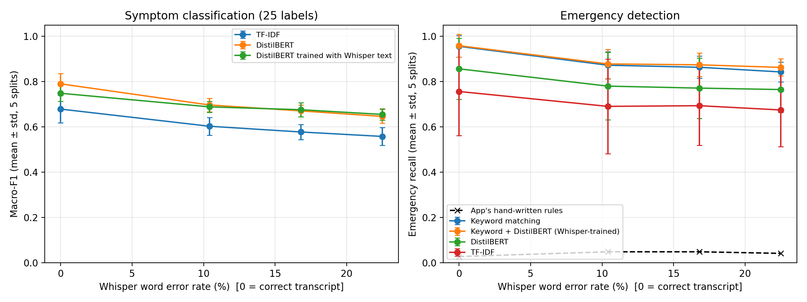
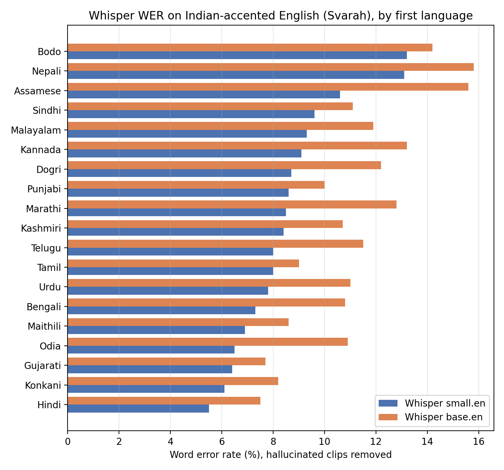

# When the Assistant Mishears: Speech-Recognition Errors in a Voice Health-Triage Pipeline

A preliminary study of how automatic speech recognition (ASR) errors propagate
into symptom classification and emergency detection, built on top of
**Voice Health Navigator**, a local voice-based symptom check-in app (described
in the second half of this README).

> **Summary.** On a public medical speech dataset (6,661 clips, 25 symptom
> labels), Whisper transcription errors reduce DistilBERT symptom-classification
> macro-F1 from 0.79 to 0.65–0.70 and cut emergency recall by roughly 10 points
> for *every* detection method tested. The safety-critical keyword is often
> the word Whisper mishears ("heart" → "hat", "harsh", "her eggs"). Training the
> classifier on Whisper transcripts did **not** recover the loss once results
> were averaged over five leak-free splits. Hand-written safety rules caught only
> 3–5% of emergencies, because people describe them in their own words.

## Research question

How much do Whisper transcription errors reduce (a) symptom classification and
(b) emergency-symptom recall in a voice triage pipeline, and do simple fixes
recover the loss?

## Key findings

1. **A careless split makes the task look solved.** The dataset repeats each
   sentence across many speakers. A random split put 546 identical sentences in
   both train and test and gave TF-IDF a macro-F1 of **0.99**; a split that keeps
   sentences separate gives **0.62** (same model, same data).
2. **ASR errors cost accuracy at every model size.** DistilBERT macro-F1 falls from
   0.79 (correct transcripts) to 0.70 / 0.67 / 0.65 on Whisper small / base / tiny.
   A stronger text model does not make the pipeline robust to ASR errors.
3. **Emergency detection loses about 10 points of recall to ASR errors, for every
   method.** The best detector (keyword matching) drops from 0.96 to 0.84–0.87.
4. **The safety keyword is the word that breaks.** When the correct transcript
   contains "heart", Whisper loses it in about 1 in 7 clips; tiny.en loses
   "breath" in 1 in 4. Aggregate WER hides this: emergency clips have *lower* WER
   than average, yet emergencies are still missed.
5. **Hand-written rules miss natural phrasing.** The app's regex safety rules
   ("chest pain", "shortness of breath") caught 3% of emergencies on correct
   transcripts.
6. **Training on Whisper transcripts did not help on average.** It looked like a
   large gain on one split (emergency recall 0.69 → 0.86) but averaged over five
   splits it is a tie (0.77–0.78 vs 0.78); it mainly made results more stable.
7. **Accent matters, and short clips trigger hallucination.** On Indian-accented
   English (Svarah), Whisper small.en WER ranges from 5.5% (Hindi first language)
   to 13.2% (Bodo) after removing hallucinated clips; both model sizes agree on
   which groups are hardest. About 3% of clips, almost all 1–2 seconds long,
   produced runaway repetition ("Two" → "Thank you. Thank you. …").

## Results

All classification results are **mean ± standard deviation over 5 leak-free
splits** (seeds 42, 1, 2, 3, 4). WER is computed on all 6,661 clips.

### Table 1: Symptom classification (macro-F1, 25 labels)

| Transcript source | WER (%) | TF-IDF + LR | DistilBERT |
|---|---|---|---|
| Correct (human) | 0.0 | 0.68 ± 0.06 | 0.79 ± 0.05 |
| Whisper small.en | 10.4 | 0.60 ± 0.04 | 0.70 ± 0.03 |
| Whisper base.en | 16.8 | 0.58 ± 0.03 | 0.67 ± 0.03 |
| Whisper tiny.en | 22.5 | 0.56 ± 0.04 | 0.65 ± 0.03 |

### Table 2: Emergency detection recall (false-alarm rate in brackets)

Emergency labels: *Heart hurts* and *Hard to breath* (as spelled in the dataset).

| Method | Correct | small.en | base.en | tiny.en |
|---|---|---|---|---|
| App's hand-written rules (all clips) | 0.03 | 0.05 | 0.05 | 0.04 |
| TF-IDF + LR | 0.76 ± 0.20 (4%) | 0.69 ± 0.21 (4%) | 0.69 ± 0.18 (5%) | 0.68 ± 0.16 (5%) |
| DistilBERT | 0.86 ± 0.14 (1%) | 0.78 ± 0.15 (2%) | 0.77 ± 0.13 (2%) | 0.77 ± 0.10 (3%) |
| DistilBERT trained with Whisper text | 0.88 ± 0.07 (2%) | 0.78 ± 0.09 (2%) | 0.78 ± 0.07 (2%) | 0.78 ± 0.08 (3%) |
| Keyword matching | **0.96 ± 0.05** (2%) | **0.87 ± 0.06** (2%) | **0.86 ± 0.05** (2%) | **0.84 ± 0.04** (2%) |
| Keyword + DistilBERT (Whisper-trained) | 0.96 ± 0.05 (2%) | 0.88 ± 0.07 (3%) | 0.87 ± 0.05 (3%) | 0.86 ± 0.04 (4%) |



### Safety-keyword survival (main split)

| Keyword | Test clips containing it | Kept by small.en | base.en | tiny.en |
|---|---|---|---|---|
| heart | 51 | 86.3% | 88.2% | 86.3% |
| breath | 20 | 95.0% | 80.0% | 75.0% |

Examples of emergency clips that were classified correctly from the human
transcript but missed after Whisper tiny.en:

| Correct transcript | Whisper tiny.en |
|---|---|
| The area around my heart doesn't feel good. | The area around my **harsh** doesn't feel good. |
| It is like I have a needle pushing through my heart. | It is like I have a needle pushing through my **hat**. |
| heart aches so much | **her eggs** so much. |
| heart aches so much | heartache so much. *(correct, but "heartache" was never seen in training)* |

### Accent analysis: Indian-accented English (Svarah)

2,090 clips (up to 110 per first language, 19 languages). Clips where Whisper's
output was more than 1.5 times longer than the reference were flagged as
hallucinations (2.5% for small.en, 3.5% for base.en) and excluded from the
cleaned WER.

| | Whisper small.en | Whisper base.en |
|---|---|---|
| WER, all clips | 10.2% | 27.7% |
| WER, hallucinations removed | 8.5% | 11.1% |
| Range across first languages (cleaned) | 5.5% (Hindi) – 13.2% (Bodo) | 7.5% (Hindi) – 15.8% (Nepali) |



### Pilot recordings (1 speaker, 20 sentences)

The author recorded 10 emergency and 10 non-emergency sentences. Four of the
emergency sentences avoid obvious keywords (for example, "I can't get enough
air"); several non-emergency sentences contain sound-alike traps ("heat",
"hard to sleep", "bad breath", "my hat").

| Transcript | WER | Keyword recall | Keyword false alarms | Rules recall | DistilBERT recall | DistilBERT false alarms |
|---|---|---|---|---|---|---|
| Correct | 0% | 6/10 | 1/10 | 0/10 | 6/10 | 3/10 |
| Whisper small.en | 2.1% | 6/10 | 1/10 | 0/10 | 6/10 | 3/10 |
| Whisper tiny.en | 2.8% | 6/10 | 1/10 | 0/10 | 6/10 | 3/10 |

Clear, read speech in a quiet room was transcribed almost perfectly, so here
the failures come from the detection methods rather than from ASR:

- Keyword matching missed all four emergencies phrased without keywords and
  flagged "bad breath".
- The rules missed even "I can't catch my breath" and "short of breath".
- DistilBERT appears to rely on surface words rather than meaning: it labelled
  "It is hard to sleep at night" and "I have bad breath" as *Hard to breath*,
  and labelled "I can't get enough air" and "I am gasping after climbing two
  steps" as *Cough*.

## Method

| Component | Details |
|---|---|
| Speech data | [Medical Speech, Transcription and Intent](https://huggingface.co/datasets/yashtiwari/PaulMooney-Medical-ASR-Data) (Figure Eight / Kaggle): 6,661 clips, 25 symptom labels, 21–35 distinct sentences per label |
| Split | `StratifiedGroupKFold` grouped by normalised sentence text (~72/14/14), so no sentence appears in more than one split; repeated with 5 seeds |
| ASR | OpenAI Whisper tiny.en, base.en, small.en via Hugging Face `transformers`, fp16, default greedy decoding, on a Colab T4 GPU |
| WER | `jiwer`, after lower-casing and removing punctuation |
| TF-IDF + LR | word 1–2-grams, sublinear TF, no stop-word removal (keeps "not", "can't"); class-balanced logistic regression, C chosen on validation |
| DistilBERT | `distilbert-base-uncased`, lr 5e-5, batch 32, max 64 tokens, 10% warm-up; 3 epochs (2 when trained on Whisper text); best epoch chosen by validation macro-F1 |
| Keyword matching | flags a transcript containing heart, chest, breath(e/ing/less), suffocat(e/ing), wheez(e/ing), chok(e/ing) or lungs. Fuzzy and phonetic (Metaphone) variants were tested; on validation they added false alarms without improving recall, so plain keywords were kept |
| Emergency recall | share of emergency clips predicted as *either* emergency label |
| Accent data | [Svarah](https://huggingface.co/datasets/ai4bharat/Svarah) (AI4Bharat, CC BY 4.0) |

## Limitations

- **Small test sets for emergencies.** Each split has about 9 distinct emergency
  sentences, which is why emergency recall varies by ±0.04–0.21 across splits.
- **Keywords overlap with label names.** Most sentences in this dataset use the
  words "heart" or "breath", so keyword matching probably looks better here than
  it would with real patients, who may say "my chest feels tight" or "I can't get
  air" (as the pilot shows).
- **Read speech by crowd workers**, not real patients, who may be distressed,
  in noisy places, or using code-mixed speech.
- **Accent results are preliminary.** Svarah has about 6 speakers per first
  language, so differences may reflect individual speakers; Svarah is also
  general-domain speech, not medical.
- **The pilot has one speaker** and only 20 sentences.
- **Only Whisper** (three English-only sizes) was tested, with greedy decoding.

## Reproduce

1. Open `research/experiments.ipynb` in Google Colab with a **T4 GPU** runtime.
2. Run the **Setup** cell after every restart (it mounts Google Drive and defines
   all helpers). Results are written to `MyDrive/asr-triage/results/`.
3. Run the blocks in order: data and leak-free split → TF-IDF baseline → Whisper
   transcription (about 30–60 min) → Table 1 → DistilBERT → matchers → repeated
   splits (about 40–60 min) → Svarah → pilot → figures.
4. All output tables and figures used above are in [`results/`](results/).

## Repository layout

```
research/experiments.ipynb   all experiments (Colab)
results/                     CSV tables and PNG figures produced by the notebook
app.py, cli.py, src/         Voice Health Navigator app (below)
data/, tests/, docs/         app data, unit tests, documentation
```

## Future work

- Test spontaneous and noisy speech, and real code-mixed (Hinglish) descriptions.
- Measure a *safety-keyword error rate* alongside WER as a standard ASR metric
  for clinical use.
- Bias Whisper toward medical vocabulary (prompting or fine-tuning) and measure
  the trade-off between keyword recall and hallucinated keywords.
- Pass ASR confidence or multiple hypotheses (N-best) to the classifier instead
  of a single transcript.

## References

- Radford et al. (2023). *Robust Speech Recognition via Large-Scale Weak Supervision* (Whisper). ICML.
- Javed et al. (2023). *Svarah: Evaluating English ASR Systems on Indian Accents*. Interspeech. [arXiv:2305.15760](https://arxiv.org/abs/2305.15760)
- Sanh et al. (2019). *DistilBERT, a distilled version of BERT*. [arXiv:1910.01108](https://arxiv.org/abs/1910.01108)
- Figure Eight / P. Mooney. *Medical Speech, Transcription, and Intent* (Kaggle). See the original page for licence terms.

---

# The app: Voice Health Navigator

A local Streamlit app that lets a person describe a health concern by voice or
text, then guides them through a short set of fixed follow-up questions and
produces a factual note to share with a clinician.

> **Safety notice.** This is an academic demonstration, not a medical device or
> clinical service. It does not diagnose diseases, recommend medicines, or
> calculate doses. For severe, sudden or worsening symptoms, contact local
> emergency services or a qualified healthcare professional immediately.

**Pipeline:** voice or text → local faster-whisper transcription → editable
transcript → deterministic safety rules → TF-IDF topic matcher (chooses a
question path only, never a diagnosis) → fixed follow-up questions, each checked
by the safety rules → factual note.

### Quick start (Windows)

```
cd /d "C:\path\to\voice-health-navigator"
python -m venv .venv
.venv\Scripts\activate.bat
python -m pip install -r requirements.txt
python -m streamlit run app.py
```

Requires Python 3.10 or 3.11. Open http://127.0.0.1:8501. The Whisper model
downloads on the first audio transcription; typed input works without it.

Text-only demo: `python cli.py --text "I have chest pain and cannot breathe"`

Tests: `python -m pip install -r requirements-dev.txt` then
`python -m unittest discover -s tests -v`

More detail: [docs/ARCHITECTURE.md](docs/ARCHITECTURE.md),
[docs/TESTING.md](docs/TESTING.md), [data/DATA_CARD.md](data/DATA_CARD.md).

## Provenance

The app reconstructs B.Tech coursework in AI in Speech Processing; it was rebuilt
in 2026 with a 2024-era Python stack. The research study above was carried out
in November 2026. Code was written with help from AI coding assistants; all
experiments were run, checked and interpreted by the author.

## Licence

Code and project-authored data: [MIT License](LICENSE). Third-party models and
datasets keep their own licences.
